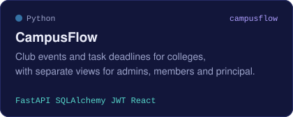
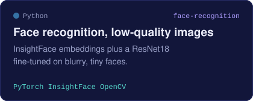
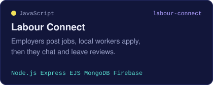
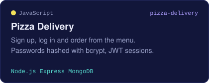
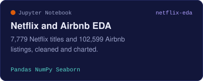
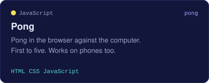
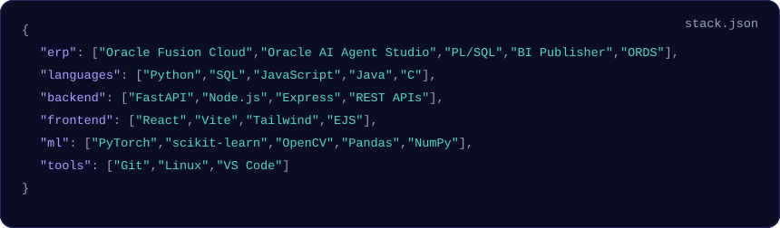

<p>
  <a href="https://vaikhashi.github.io"><b>Portfolio</b></a> &nbsp;/&nbsp;
  <a href="https://www.linkedin.com/in/vaikhashi-a-7ab540237">LinkedIn</a> &nbsp;/&nbsp;
  <a href="mailto:vaikhashi3134@gmail.com">Email</a> &nbsp;/&nbsp;
  <a href="https://orcid.org/0009-0003-9011-3534">ORCID</a>
</p>

### Projects

<a href="https://github.com/Vaikhashi/Campusflow"></a>
<a href="https://github.com/Vaikhashi/FaceRecognitionTask"></a>
<a href="https://github.com/Vaikhashi/labour-Connect"></a>
<a href="https://github.com/Vaikhashi/Pizza-Delivery-App---Level-3"></a>
<a href="https://github.com/Vaikhashi/VOIS_AICTE_Oct2025_VaikhashiA"></a>
<a href="https://github.com/Vaikhashi/pong-game"></a>

Every one of these has a demo you can play on my [portfolio](https://vaikhashi.github.io/#projects).

### Stack



Shortlisted for the IET India Scholarship Award, regional round.

<details>
<summary><b>Don't click this</b></summary>
<br>

```
        /\
       /  \
      |    |
      | VA |
      |    |
     /|/\/\|\
    /_|    |_\
       '  '
```

Okay, you clicked. There's a game of Pong hidden on my portfolio: open [vaikhashi.github.io](https://vaikhashi.github.io), press <kbd>/</kbd> and type `pong`. If you win, try `launch`.

</details>


